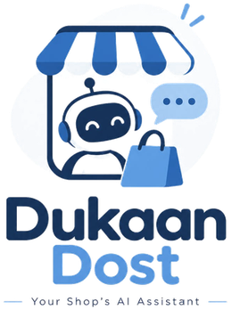

__<p align="center">
  
</p>

<h1 align="center">Dukaan Dost</h1>

<p align="center">
  <b>An AI shop assistant for small Pakistani businesses that sell on WhatsApp.</b><br>
  Replies in Roman Urdu, Urdu or English · takes orders and bookings · bargains only within the owner's limits · flags fake cash-on-delivery orders before they ship.<br>
  Powered by <b>NVIDIA Nemotron 3 (Nano, Super, Ultra)</b> on <b>Nebius Token Factory</b>.
</p>

<p align="center">
  Live demo and video: see our Devpost submission ·
  <a href="FEEDBACK.md">Feedback for Nebius and NVIDIA</a>
</p>

<p align="center">
  Nebius x NVIDIA Global AI Hackathon · Track: <b>Best Apps and Agents</b> · License: MIT
</p>

<!-- Screenshots: on GitHub, edit this file, select a SHOT word and paste (Ctrl+V) a screenshot over it. -->
| Customer chat (Roman Urdu + bargaining) | Owner dashboard | AI routing and cost |
| --- | --- | --- |
| SHOT-1 | SHOT-2 | SHOT-3 |

---

## Who it's for

Ayesha runs a home bakery in Karachi from Instagram and WhatsApp. Between baking, she answers "kitne ka hai?" fifty times a day, misses orders while her hands are in the dough, and last month lost two cakes to cash-on-delivery customers who never picked up. Dukaan Dost answers her customers in their own Roman Urdu, takes the order, bargains only as far as she allows, and warns her before she bakes for a risky COD order.

## Why Dukaan Dost is different

Most WhatsApp bots are English FAQ menus or a general chatbot with a prompt. Dukaan Dost is built for how Pakistani small shops actually sell:

1. **Roman Urdu first.** It understands mixed Roman Urdu, Urdu and English, and replies in the customer's own style.
2. **Bargaining with hard limits.** Customers expect to haggle. The AI can negotiate, but every discount is checked in Python against the owner's limit, so it can't be talked below it.
3. **Fake COD protection.** Every cash-on-delivery order gets a risk level with plain reasons before the owner prepares it.
4. **The owner stays in control.** Complaints, big or urgent orders and unknown questions go to the owner, who can take over any chat.
5. **Right-sized AI.** Nano handles every message, Super runs the order agent, and Ultra is used only for monthly advice, with daily budget limits, so it's cheap enough for a small shop.
6. **Loyalty reward.** Every 5th order gets 10% off, counted in code (the owner can change the numbers).

## Try it in 2 minutes

1. Open the live demo (link in our Devpost submission).
2. On **Overview**, click **Load sample shop**. This loads *Sweet Crumbs Bakery*: a made-up Karachi home bakery with 20 customers and about 3 months of orders, all labelled demo data.
3. Open **Customer chat** and type as a customer:
   - `Assalam o alaikum, 1kg chocolate cake kitne ka hai?`
   - `Thora discount ho jaye? 2 cake lun gi`
   - `Theek hai, order kar dein. Gulshan delivery`
4. Open **Orders** as the owner: the new order is there with its cash-on-delivery risk level and the reasons.
5. Open **Insights** for daily and monthly profit, and ask the AI advisor for this month's tips.

> The backend runs on a free plan and may take a few seconds to wake up on the first request.

## The problem

Millions of small businesses in Pakistan (home bakers, boutiques, tailors, pharmacies) run entirely on WhatsApp.
The owner is also the cook, the tailor or the shopkeeper, so:

- they answer the same questions about price, delivery and timing all day;
- orders get missed while they are busy;
- fake cash-on-delivery orders (wrong address, customer not answering) waste ingredients and delivery money;
- they have no clear view of daily sales or profit.

Customers write in a mix of Roman Urdu, Urdu and English, and they expect to bargain. A generic English chatbot doesn't fit.

## What Dukaan Dost does

- **Understands how customers actually write.** Roman Urdu, Urdu script, English and mixed messages, and replies in the same style.
- **Answers FAQs** from the shop's own data: prices, delivery areas, timings, payment.
- **Takes orders and bookings** through a tool-calling agent.
- **Bargains safely.** The model can only offer discounts that Python checks against the owner's limits, so a customer can't talk it into a bigger discount.
- **Flags risky COD orders** with plain reasons, such as a vague address, a new customer, a large first order, or past cancellations.
- **Hands off to the owner** for complaints, urgent or large orders, and questions it can't answer. The owner can take over a chat from the Inbox.
- **Remembers repeat customers** and their addresses.
- **Owner insights:** daily and monthly sales, profit and top products, plus monthly advice from Nemotron 3 Ultra.
- **Market price check (Tavily):** "What do other shops charge for this?" Web search, then Nemotron Super reads the prices, then Python compares.
- **5-minute setup:** the owner pastes their menu as plain text and Nemotron Super turns it into products and prices.

## How we use NVIDIA Nemotron and Nebius Token Factory

All AI calls go through the **Nebius Token Factory** OpenAI-compatible API. We route each task to the smallest model that handles it well, so the app stays fast and the credits last.

| Model (Token Factory) | Used for | Why this model |
| --- | --- | --- |
| **Nemotron 3 Nano** (30B-A3B) | Every message: language, intent and urgency detection; FAQ replies; short summaries | Fast and cheap enough to run on every message |
| **Nemotron 3 Super** (120B-A12B) | Tool-calling agent for orders, bookings and bargaining (max 6 steps); reading a pasted menu; reading prices out of Tavily results | Reliable multi-step tool use |
| **Nemotron 3 Ultra** (550B-A55B) | Monthly business advisor, only when the owner asks; the answer is cached | Deep reasoning over a month of numbers; rare call, so it costs about a cent |

**See the routing live:** in **Customer chat**, every reply shows which model handled it (for example *Nemotron Nano → Nemotron Super*) and what it understood. These labels are for the demo; customers on WhatsApp only see the replies.

**What the model never does:** prices, totals, discounts and COD risk scores are always calculated in Python. The model decides *what* to do; code decides the numbers.

**Cost controls built in:**
- per-phone and whole-app daily message limits, and a daily AI budget in USD; no AI call is made once a limit is reached;
- every call's tokens and estimated cost are counted (`GET /usage`, shown in **Settings → AI and usage**);
- Ultra is called only on demand and cached;
- a $0 **practice mode** (no key needed) uses the same tools with simple rules, for testing.

## Architecture

```
Customer (web chat, or WhatsApp via Twilio)
   │
   ▼
FastAPI backend ──► Nemotron 3 Nano: language + intent + urgency
   │                    ├─ FAQ ──────────────► answer from shop data
   │                    └─ order / booking / bargain ──► Nemotron 3 Super agent + tools
   │                                                        (get_products, check_discount,
   │                                                         preview/confirm_order, create_booking, flag_owner)
   ├─ COD risk rules (Python)
   ├─ Database: Firebase Firestore (or in-memory)
   ▼
Owner dashboard (React + Vite): Overview · Customer chat · Inbox · Orders · Customers · Insights · Settings

Owner asks "what do others charge?" ──► Tavily search ──► Nemotron Super reads prices ──► Python compares
Owner asks for monthly advice ──► numbers (Python) + market prices ──► Nemotron 3 Ultra ──► 3–5 tips
Every night ──► daily_report.py ──► Nano writes a short note ──► owner (dashboard / WhatsApp)
                (can run as a Nebius Serverless Job)
```

## Deployment (live)

| Part | Where |
| --- | --- |
| Frontend (React + Vite) | Vercel, root directory `frontend` |
| Backend (FastAPI) | Vercel (Python), entry point `app.py` at the repo root |
| AI models | Nebius Token Factory: Nemotron 3 Nano, Super, Ultra |

The live links are in our Devpost submission.

**Deploy your own copy (free, no card):**
1. **Backend:** on Vercel, import this repo with Root Directory `./` (Vercel detects FastAPI from `app.py`). Add the environment variables from `.env.example`; at minimum `NEBIUS_API_KEY`.
2. **Frontend:** import the same repo again with Root Directory `frontend` (Vite), and add `VITE_API_URL` = your backend URL.
3. **Firebase (recommended on Vercel):** the backend restarts often there, so in-memory data doesn't last. Set `FIREBASE_CREDENTIALS` to the full JSON text of a Firebase service-account key. The code accepts either a file path or the JSON text.

`render.yaml` and the `Dockerfile` are also included. The backend and the nightly report (`daily_report.py`) can run as a Nebius Serverless Endpoint and Job; we have not deployed them there yet.

## Run it locally

**Backend** (Python 3.12):
```bash
git clone https://github.com/Sehar2376/Dukaan_Dost.git
cd Dukaan_Dost/backend
python -m venv venv
venv\Scripts\activate            # Mac/Linux: source venv/bin/activate
pip install -r requirements.txt
copy ..\.env.example .env        # Mac/Linux: cp ../.env.example .env   then add your NEBIUS_API_KEY
uvicorn main:app --reload
```
Open http://localhost:8000/docs, run `POST /admin/load-demo`, then try `POST /chat` with
`{"phone": "03001234567", "message": "Delivery charges kitne hain?"}`.

No key yet? Leave `NEBIUS_API_KEY` empty and the app runs in **practice mode** ($0, replies start with "(practice)").

**Frontend** (Node.js 18+), in a second terminal:
```bash
cd frontend
npm install
copy .env.example .env           # Mac/Linux: cp .env.example .env
npm run dev
```
Open http://localhost:5173.

**Tests:** `pytest -q` in `backend` runs 79 offline tests with a fake Nemotron (no key needed). Classifier accuracy check against labelled messages: `python test_classify.py` (needs a key).

## Settings

Each optional feature switches on when its setting is filled in; if it's empty, the app still works.

| Feature | Setting | Without it |
| --- | --- | --- |
| Real Nemotron AI | `NEBIUS_API_KEY` | Practice mode (rule-based, $0) |
| Saved data | `FIREBASE_CREDENTIALS` (file path or JSON text) | In-memory data, lost on restart |
| Fewer Firebase reads | `FIRESTORE_CACHE_SECONDS` (default 120) | Data is re-read from Firebase every 2 minutes |
| Market price check | `TAVILY_API_KEY` | Clearly labelled sample results |
| WhatsApp | `TWILIO_ACCOUNT_SID`, `TWILIO_AUTH_TOKEN`, `PUBLIC_BASE_URL` | Web chat only |
| Nightly report on WhatsApp | `OWNER_WHATSAPP` (+ Twilio) | Report shown in the dashboard only |
| Cost limits | `DAILY_MESSAGE_LIMIT`, `TOTAL_DAILY_LIMIT`, `DAILY_BUDGET_USD` | Defaults: 40 / 500 / $1.50 per day |

## API endpoints

Full interactive docs: `/docs` on the running backend.

| Method | Endpoint | Purpose |
| --- | --- | --- |
| POST | `/chat` | Customer message in, AI reply out |
| POST | `/webhook/whatsapp` | Twilio WhatsApp messages (signature checked) |
| GET · PATCH | `/orders` · `/orders/{id}` | Orders with COD risk and reasons · mark delivered or cancelled |
| GET · POST | `/flags` · `/flags/{id}/resolve` | Owner alerts: complaints, unknown questions, risky or large orders |
| GET | `/conversations` · `/conversations/{phone}` | Chats for the owner |
| POST | `/conversations/{phone}/takeover` · `/reply` | Owner pauses the AI and replies |
| GET | `/bookings` · `/customers` | Bookings and customer memory |
| GET · POST | `/setup` · `/setup/parse` · `/setup/save` | 5-minute setup (Super reads a pasted menu) |
| GET | `/summary/daily` · `/summary/monthly` | Sales, profit, top products, chart data, AI note |
| GET | `/advice/monthly` | AI business advisor (Nemotron 3 Ultra), cached |
| GET | `/usage` | Today's AI calls, tokens and estimated cost |
| POST · GET | `/market/check` · `/market/checks` | Market price check (Tavily + Super + Python) |
| POST · GET | `/admin/run-daily-report` · `/reports` | Nightly owner report |
| POST | `/admin/load-demo` | Load labelled demo data |

## Limitations (honest list)

- The demo uses made-up data and has no login yet, so anyone with the link can see and reset it. Don't enter real customer details. AI spending is capped per day.
- Without Firebase, data lives in memory and resets when the backend restarts (often, on Vercel).
- WhatsApp needs a Twilio account; the Twilio sandbox only works for numbers that join it first.
- If Nemotron 3 Ultra isn't available in a region, the advisor falls back to Nemotron 3 Super.
- Roman Urdu spelling varies a lot ("kitne", "kitnay", "ktny"); unusual spellings can still be misread. Unclear messages go to the owner.
- COD risk uses simple, explainable rules, not a trained model.

## Project structure

```
app.py              Vercel entry point (loads backend/main.py)
requirements.txt    Python packages for Vercel (same as backend/requirements.txt)
backend/
  main.py           FastAPI app and all endpoints
  ai.py             Token Factory calls (Nano, Super, Ultra), cost tracking, budget checks
  agent.py          Nemotron Super tool-calling loop (max 6 steps)
  tools.py          get_products, check_discount, preview/confirm_order, create_booking, flag_owner
  risk.py           COD risk rules (pure Python)
  summary.py        daily and monthly numbers (all maths in Python)
  market.py         Tavily market price check
  practice.py       practice-mode agent (no key needed)
  daily_report.py   nightly owner report (can run as a Nebius Serverless Job)
  db.py             Firestore, or in-memory when FIREBASE_CREDENTIALS is empty
  prompts/          system prompts as .txt files
  tests/            offline tests with a fake Nemotron
frontend/
  src/pages/        7 pages in the menu: Overview, Customer chat, Inbox, Orders, Customers, Insights, Settings.
                    Sections inside them: Bookings (in Orders), Market prices and AI advice (in Insights),
                    Setup and AI usage (in Settings), Alerts (in Inbox)
  src/components/   design system, layout, icons
sample_data/        demo shop + load_sample.py
Dockerfile          container for Nebius Serverless Endpoints / Jobs (optional)
render.yaml         Render blueprint (optional)
```

## Built during the hackathon

All code was written during the submission period (started Sep 25, 2026) by a team of three:
**Sehar Emaan** (backend and AI), **Mahira Hassan** (frontend) and **Midhya Rani** (tests, demo data and docs).

## Feedback

Our feedback on Nebius Token Factory and NVIDIA Nemotron is in [FEEDBACK.md](FEEDBACK.md).

## License

MIT. See [LICENSE](LICENSE).
